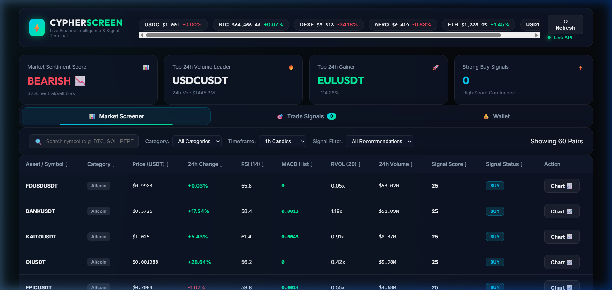
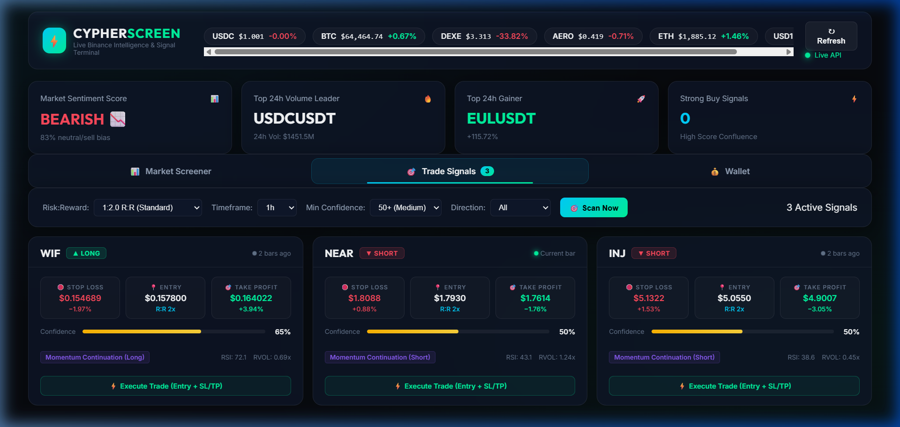
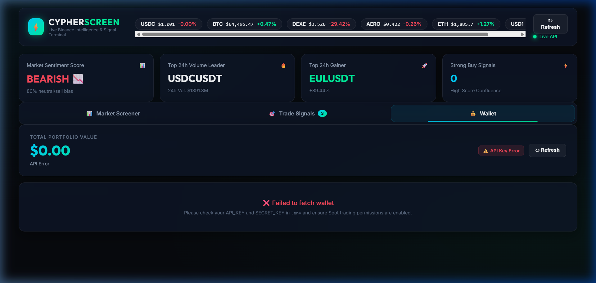
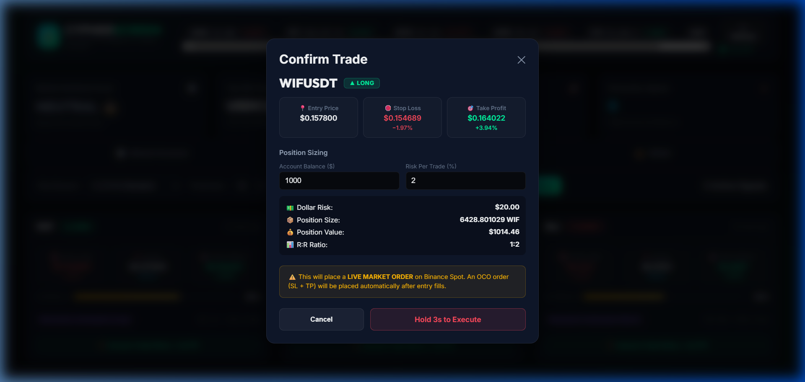

# Binance Live Crypto Analysis & Screener

> A high-performance, real-time Cryptocurrency Market Screener and Technical Analysis platform powered by the Binance REST API. Features parallel multi-factor pair screening, vectorized technical indicators, signal scoring, an interactive web dashboard, and dedicated Jupyter notebooks for exploratory data analysis.

---

## Key Features

1. **Secure Credential Management**:
   - Strictly git-ignored `.env` file for private `API_KEY` and `SECRET_KEY`.
   - `.env.example` template for public repository deployment without secret leaks.

2. **Real-Time Technical Analysis Engine**:
   - **RSI (14)**: Relative Strength Index oversold (<30) and overbought (>70) detection.
   - **MACD (12, 26, 9)**: Bullish & Bearish signal line crossover tracking.
   - **EMA Stack (9, 21, 50, 200)**: Trend direction stack & Golden Cross identification.
   - **Bollinger Bands (20, 2)**: Bandwidth percentage calculation and volatility compression.
   - **RVOL (Relative Volume)**: Volume spike detection vs 20-period moving average.
   - **ATR (14)**: Average True Range calculation for dynamic Stop Loss & Take Profit targets.

3. **Multi-Factor Crypto Screener**:
   - Parallel multi-threaded scanning across Binance USDT pairs.
   - Composite Signal Scoring model (-100 to +100) categorizing pairs into **STRONG BUY**, **BUY**, **NEUTRAL**, **SELL**, or **STRONG SELL**.
   - Sector/Category filters (Layer 1, AI / Data, DeFi, Meme, Layer 2).

4. **Timeframe-Aware Strategy Lab & Composite Quality Scoring**:
   - **Higher-Timeframe Alignment**: Live signal generation cross-references higher timeframes (15m → 1h, 1h → 4h, 4h → 1d) via EMA 21/50 slope and price structure.
   - **Empirical Edge Registry**: Every strategy carries 6-month walk-forward statistics for **1H** and **4H**, including profit factor, win rate, trade count, average net trade return, max drawdown, and Sharpe. Tiers are derived transparently from the stats instead of being hardcoded.
   - **Strategy Lab UI**: A dedicated tab ranks all 23 strategies by the active timeframe, shows 1H vs 4H profit factors side by side, flags proxied timeframes, and exports the table to CSV.
   - **Composite Quality Score**: Each live signal is ranked by `55% indicator confidence + 30% empirical edge + 15% freshness + regime fit`. Negative-expectancy strategies are capped at **B**, PF < 0.95 at **C**, and tiny samples (<10 trades) at **B** so a strong current candle can never masquerade as an elite setup.
   - **Strategy-Aware MTF**: Trend and breakout strategies require higher-timeframe alignment; mean-reversion and order-flow strategies may deliberately fade the higher timeframe.

5. **Autonomous Trading Bot & Advanced Risk Guardrails**:
   - **Dynamic Breakeven Stop Ratchet**: When an open position reaches $\ge 1.0R$ profit, the bot automatically moves the Stop-Loss to entry + fee buffer to lock in a risk-free trade.
   - **Strategy-Aware MTF Filter**: Blocks counter-trend entries only for trend/breakout setups, allowing mean-reversion fades where appropriate.
   - **Empirical Edge Gate**: Skips any setup whose timeframe-specific backtest expectancy is ≤ 0R after fees and slippage.
   - **Best Setup per Symbol**: Prevents stacking correlated trades when several strategies fire on the same pair.
   - **Dynamic Position Sizing**: Supports Fixed USDT, Percent of Capital, and Kelly/Risk % sizing models with leverage and emergency square-off.

6. **Interactive Web Dashboard & Pro High-Definition Chart Engine**:
   - Glassmorphic dark trading UI built with vanilla HTML/CSS/JS.
   - **Pro HD Multi-Pane Charting**: DPI-aware canvas chart with Price Candlesticks, Volume, and an integrated RSI (14) sub-pane (70/50/30 zones).
   - **Dynamic Overlays**: EMA 9, 21, 50, Bollinger Bands envelopes/clouds, and trade setup target zones (Entry, SL, TP).
   - **Trade Signals Terminal**: Real-time coin/strategy search, MTF filter, quality/edge filters, tier badges, quality grades, and 1-click chart visualization.
   - **Market Screener Enhancements**: 24-close sparkline trend column, instrument regime, ATR %, and one-click CSV export.
   - **Live Wallet & Bot Monitor**: Real-time open positions, trailing SL tracker, PnL analytics, and audit journal.
   
   
   
   
   
   
   
   

7. **Interactive Jupyter Notebooks**:
   - `01_binance_data_exploration.ipynb`: Market summary, 24-hour volume leaders, and candlestick ingestion.
   - `02_indicator_deep_dive.ipynb`: Multi-indicator plotting with Plotly dark themes.
   - `03_screener_backtest.ipynb`: Backtesting technical signal rules against historical klines.
   - `04_strategy_backtest_comparison.ipynb`: 20-strategy comparison with win rate, Sharpe ratio, equity curves, and composite ranking.
   - `05_multi_timeframe_analysis.ipynb`: Multi-timeframe (5m/15m/1h/4h) 20-strategy comparison plus Crypto vs Gold (XAUTUSDT, PAXGUSDT) analysis.
   - `06_atr_risk_management_backtest.ipynb`: Bar-by-bar ATR Stop-Loss & Take-Profit simulator testing 1:1.5, 1:2.0, and 1:3.0 Risk-to-Reward ratios and account equity growth ($1,000 capital, 2% risk/trade).
   - `07_profitable_strategies_backtest.ipynb`: 6-month regime-aware institutional backtest across bull/bear/range markets with 0.21% friction.

---

## Repository Structure

```
crypto-trading/
├── .env                               # Private API credentials (GIT IGNORED)
├── .env.example                       # Safe environment variable template
├── .gitignore                         # Standard exclusion rules
├── README.md                          # Documentation & project guide
├── requirements.txt                   # Dependencies (FastAPI, Pandas, Jupyter, Plotly)
├── run_backtest.py                    # 6-Month multi-pair institutional backtesting CLI
├── start.sh                           # 1-Click launcher script (macOS / Linux)
├── run.sh                             # Launcher shortcut (macOS / Linux)
├── start.bat                          # 1-Click launcher script (Windows)
├── run.bat                            # Launcher shortcut (Windows)
├── assets/
│   └── screenshots/                   # UI documentation screenshots
├── notebooks/                         # Jupyter Notebooks for analysis
│   ├── 01_binance_data_exploration.ipynb
│   ├── 02_indicator_deep_dive.ipynb
│   ├── 03_screener_backtest.ipynb
│   ├── 04_strategy_backtest_comparison.ipynb
│   ├── 05_multi_timeframe_analysis.ipynb
│   ├── 06_atr_risk_management_backtest.ipynb
│   └── 07_profitable_strategies_backtest.ipynb
├── data_cache/                        # 6-month 1H/4H parquet candles for 8 pairs
├── backend/
│   ├── config.py                      # Environment configuration loader
│   ├── binance_client.py              # REST API client with failover endpoints
│   ├── data_fetcher.py                # Candle download & parquet cache management
│   ├── indicators.py                  # Vectorized Technical Indicators Engine
│   ├── strategies.py                  # Strategy registry + empirical performance tiers
│   ├── screener.py                    # Multi-pair Screener & Signal Scoring
│   ├── trade_signals.py               # Quality scoring, MTF/regime filters, dedupe
│   ├── backtester.py                  # ATR stop/target institutional simulator
│   ├── auto_trader.py                 # Paper/live bot with edge & quality gates
│   ├── risk_manager.py                # Position sizing and risk limits
│   ├── regime.py                      # Instrument-level regime classification
│   ├── macro_regime.py                # Benchmark macro regime detection
│   ├── mtf_filter.py                  # Higher-timeframe bias alignment
│   ├── high_delta_scanner.py          # High-delta opportunity scanner
│   ├── position_tracker.py            # Open position lifecycle tracking
│   ├── trade_journal.py               # Trade history persistence
│   └── app.py                         # FastAPI Web Server & Static File Host
└── frontend/
    ├── index.html                     # Web Dashboard layout
    ├── css/
    │   └── styles.css                 # Dark mode glassmorphic CSS theme
    └── js/
        ├── api.js                     # API communications client
        ├── chart.js                   # Canvas candlestick charting renderer
        └── app.js                     # Interactive table UI & position calculator
```

---

## Quick Start Guide

### 🍎 1-Click Launch (macOS & Linux)
Open your terminal in this repository and run:
```bash
./start.sh
# or
./run.sh
```
- It automatically verifies Python (Python 3.10+), installs missing dependencies if needed, creates a `.env` template if missing, starts the FastAPI server, and opens **`http://127.0.0.1:8050`** (or 8000) in your default web browser.

---

### 🚀 1-Click Launch (Windows)
Simply **double-click** `start.bat` or run:
```bat
start.bat
```
- It automatically verifies Python, installs missing dependencies if needed, starts the FastAPI server, and opens the dashboard in your default browser.

---

### Manual Launch


#### 1. Prerequisites
- Ensure you have **Python 3.10+** installed.
- A **Binance Account** is required to generate API keys for live data and trading. If you don't have one, you can [sign up here using this referral link](https://www.binance.com/referral/earn-together/refer2earn-usdc/claim?hl=en-IN&ref=GRO_28502_VRJ5Y&utm_source=referral_entrance) to claim a sign-up bonus.

#### 2. Configure Environment Variables
Copy `.env.example` to `.env` and enter your Binance API Key and Secret:
```bash
cp .env.example .env
```
*(Your `.env` file is protected by `.gitignore` and will never be committed to Git.)*

#### 3. Install Dependencies
Install required packages using `pip`:
```bash
pip install -r requirements.txt
```

#### 4. Run the Screener Server & Web Dashboard
Launch the FastAPI server:
```bash
python -m backend.app
# OR
python -m uvicorn backend.app:app --host 127.0.0.1 --port 8000 --reload
```
Open your browser and navigate directly to:
👉 **`http://127.0.0.1:8000`** (or `/index`, `/dashboard`)


---

## Using Jupyter Notebooks

Launch Jupyter Notebook to perform custom research and backtesting:
```bash
jupyter notebook
```
Navigate to the `notebooks/` directory and open any of the notebooks:
- **`01_binance_data_exploration.ipynb`**: Fetch 24-hour market metrics & ticker statistics.
- **`02_indicator_deep_dive.ipynb`**: Plot RSI, MACD, and EMA charts interactively.
- **`03_screener_backtest.ipynb`**: Test technical signal win-rates against historical candles.
- **`04_strategy_backtest_comparison.ipynb`**: Full 20-strategy backtest comparison with performance metrics, heatmaps, and equity curves.
- **`05_multi_timeframe_analysis.ipynb`**: Multi-timeframe (5m/15m/1h/4h) analysis and Crypto vs Gold comparison.
- **`06_atr_risk_management_backtest.ipynb`**: Dynamic ATR Stop-Loss / Take-Profit backtester with account equity growth simulation.
- **`07_profitable_strategies_backtest.ipynb`**: 6-month regime-aware institutional backtest evaluating multi-factor confluence across 8 crypto pairs.

---

## 📊 Backtest Engine & Empirical Strategy Performance

The platform includes a CLI backtest runner ([`run_backtest.py`](run_backtest.py)) and institutional simulation engine ([`backend/backtester.py`](backend/backtester.py)) testing **23 confluence strategies** over **6 months** across 8 high-volume pairs (`BTCUSDT`, `ETHUSDT`, `SOLUSDT`, `BNBUSDT`, `XRPUSDT`, `AVAXUSDT`, `NEARUSDT`, `DOGEUSDT`) on both **1H and 4H** candles. The results are stored in [`backend/strategies.py`](backend/strategies.py) as `STRATEGY_PERFORMANCE` and drive live signal tiers, quality scores, and the Strategy Lab — the documentation below is generated from that same registry.

### Realistic Institutional Constraints
* **Friction & Fees**: 0.075% Binance taker fee + 0.03% slippage per side (**0.21% roundtrip friction**).
* **Dynamic ATR Risk Controls**: Stop Loss set to `2.0x ATR` (noise-immune breathing room), Take Profit set to `3.5x ATR` (1:1.75 true reward-to-risk ratio).
* **Position Mutex**: Non-overlapping entries matching live bot execution, with a 48-bar maximum hold.

### Why Timeframe Matters

Strategy edge is **not** uniform across timeframes. The scanner measures each strategy's net average trade return (`avg_trade_pct`, after friction) on every available timeframe and automatically uses the **best timeframe per strategy**. At 1H, 8 of 23 strategies have positive expectancy (average PF 0.94); at 4H, 13 of 23 do (average PF 1.09). Treating all strategies as equally valid on every timeframe is the single biggest source of false signals.

#### 1-Hour Results — Momentum & Breakout Scalps
Sorted by average net trade return. Only 8 of 23 strategies clear positive expectancy.

| Strategy | Dir | Trades | Win Rate | Avg Trade | PF | Return | Max DD | Tier |
| :--- | :---: | :---: | :---: | :---: | :---: | :---: | :---: | :---: |
| **Trend Pullback (Long)** | LONG | 97 | 41.2% | +0.274% | **1.265** | -0.6% | -17.5% | A |
| **Breakout Retest (Long)** | LONG | 329 | 43.8% | +0.212% | **1.205** | +13.8% | -29.3% | A |
| **VWAP Reversion (Long)** | LONG | 102 | 48.0% | +0.139% | **1.131** | +8.6% | -10.5% | B+ |
| **Mean Reversion (Short)** | SHORT | 204 | 42.2% | +0.114% | **1.101** | +8.4% | -18.6% | B+ |
| **Squeeze Breakout (Long)** | LONG | 293 | 41.3% | +0.110% | **1.101** | -2.0% | -25.8% | B+ |
| **Breakout Retest (Short)** | SHORT | 260 | 38.5% | +0.104% | **1.091** | -15.3% | -48.4% | B+ |
| **Squeeze Breakout (Short)** | SHORT | 164 | 39.0% | +0.049% | **1.055** | -11.7% | -38.1% | B+ |
| **Supertrend Regime (Long)** | LONG | 312 | 42.0% | +0.025% | **1.023** | -11.6% | -36.8% | B |
| EMA Golden Cross (Long) | LONG | 344 | 36.9% | -0.000% | 1.000 | -36.3% | -56.5% | B |
| VWAP Reversion (Short) | SHORT | 96 | 38.5% | -0.046% | 0.960 | -3.2% | -16.0% | B |
| Volume Breakout (Long) | LONG | 225 | 37.3% | -0.073% | 0.937 | -27.1% | -36.6% | C |
| Supertrend Regime (Short) | SHORT | 118 | 33.9% | -0.104% | 0.896 | -18.3% | -31.3% | C |
| Mean Reversion (Long) | LONG | 223 | 42.6% | -0.110% | 0.902 | -13.0% | -21.7% | C |
| Taker Pressure (Long) | LONG | 346 | 43.9% | -0.135% | 0.877 | +0.4% | -29.2% | C |
| EMA Death Cross (Short) | SHORT | 323 | 37.5% | -0.142% | 0.867 | -29.3% | -42.0% | C |
| Taker Pressure (Short) | SHORT | 455 | 38.7% | -0.142% | 0.860 | -37.0% | -42.0% | C |
| Momentum Continuation (Long) | LONG | 351 | 37.6% | -0.164% | 0.877 | -34.5% | -47.5% | C |
| Oversold Dip Bounce (Long) | LONG | 392 | 35.5% | -0.196% | 0.849 | -49.0% | -56.9% | C |
| RSI Divergence (Long) | LONG | 104 | 41.4% | -0.239% | 0.813 | -5.6% | -15.5% | C |
| RSI Divergence (Short) | SHORT | 125 | 37.6% | -0.268% | 0.784 | -15.2% | -20.7% | C |
| Momentum Continuation (Short) | SHORT | 322 | 35.4% | -0.286% | 0.772 | -37.0% | -53.5% | C |
| Volume Breakout (Short) | SHORT | 229 | 33.6% | -0.292% | 0.762 | -37.3% | -52.0% | C |
| Trend Pullback (Short) | SHORT | 67 | 35.8% | -0.596% | 0.479 | -13.0% | -17.2% | C |

#### 4-Hour Results — Swing & Mean-Reversion Edge
Sorted by average net trade return. 13 of 23 strategies are profitable, and the best 4H edges are materially stronger than anything on 1H.

| Strategy | Dir | Trades | Win Rate | Avg Trade | PF | Return | Max DD | Tier |
| :--- | :---: | :---: | :---: | :---: | :---: | :---: | :---: | :---: |
| **RSI Divergence (Short)** | SHORT | 21 | 47.6% | +1.364% | **1.852** | +3.4% | -4.2% | A+ |
| **RSI Divergence (Long)** | LONG | 29 | 51.7% | +1.117% | **1.554** | +8.5% | -6.5% | A+ |
| **Momentum Continuation (Long)** | LONG | 96 | 52.1% | +1.063% | **1.567** | +26.7% | -18.7% | A+ |
| **Oversold Dip Bounce (Long)** | LONG | 102 | 50.0% | +1.048% | **1.615** | +24.6% | -17.0% | A+ |
| **Supertrend Regime (Short)** | SHORT | 26 | 50.0% | +0.809% | **1.478** | +7.6% | -5.7% | A+ |
| **EMA Golden Cross (Long)** | LONG | 92 | 42.4% | +0.623% | **1.334** | +10.0% | -12.7% | A |
| **Squeeze Breakout (Short)** | SHORT | 30 | 50.0% | +0.597% | **1.370** | +8.2% | -10.2% | A |
| **VWAP Reversion (Short)** | SHORT | 24 | 41.7% | +0.432% | **1.223** | +1.9% | -7.0% | A |
| **Mean Reversion (Long)** | LONG | 46 | 43.5% | +0.299% | **1.160** | +3.9% | -14.3% | A |
| **VWAP Reversion (Long)** | LONG | 16 | 50.0% | +0.288% | **1.167** | +1.3% | -4.6% | A |
| Mean Reversion (Short) | SHORT | 47 | 34.0% | +0.255% | 1.125 | -6.2% | -14.7% | B+ |
| Trend Pullback (Short) | SHORT | 13 | 46.1% | +0.093% | 1.053 | +1.4% | -3.4% | B+ |
| Supertrend Regime (Long) | LONG | 65 | 35.4% | +0.051% | 1.027 | -3.4% | -14.1% | B |
| Taker Pressure (Short) | SHORT | 61 | 42.6% | -0.034% | 0.981 | -1.1% | -7.5% | B |
| Trend Pullback (Long) | LONG | 22 | 45.5% | -0.136% | 0.949 | +2.6% | -5.7% | C |
| Volume Breakout (Short) | SHORT | 64 | 35.9% | -0.329% | 0.834 | -5.5% | -22.3% | C |
| EMA Death Cross (Short) | SHORT | 92 | 38.0% | -0.437% | 0.805 | -10.5% | -21.5% | C |
| Squeeze Breakout (Long) | LONG | 69 | 36.2% | -0.468% | 0.788 | -6.1% | -13.0% | C |
| Breakout Retest (Short) | SHORT | 46 | 32.6% | -0.496% | 0.786 | -7.0% | -11.1% | C |
| Volume Breakout (Long) | LONG | 54 | 35.2% | -0.558% | 0.799 | -5.1% | -6.9% | C |
| Taker Pressure (Long) | LONG | 43 | 25.6% | -0.916% | 0.647 | -15.7% | -15.1% | C |
| Breakout Retest (Long) | LONG | 69 | 24.6% | -1.343% | 0.511 | -22.1% | -23.8% | C |
| Momentum Continuation (Short) | SHORT | 41 | 24.4% | -2.097% | 0.331 | -15.0% | -21.0% | C |

### Tier Rules

Tiers are computed from **empirical profit factor and sample size**, never from the number of indicators a setup happens to trigger.

| Tier | Requirement | Interpretation |
| :---: | :--- | :--- |
| **A+** | PF ≥ 1.40 and ≥ 20 trades | Strong, statistically usable edge |
| **A** | PF ≥ 1.15 | Solid edge |
| **B+** | PF ≥ 1.05 | Modest edge; needs confirmation |
| **B** | PF ≥ 0.95 | Breakeven-ish; reduce size |
| **C** | PF < 0.95 or < 10 trades | Negative expectancy or unusable sample |

### Composite Quality Score

Every live signal is scored 0–100:

```
quality = 0.55 × indicator confidence
        + 0.30 × empirical edge score
        + 0.15 × freshness score
        + regime adjustment (±5)
```

* **Empirical edge** converts the strategy's backtested `avg_trade_pct` into R multiples using the setup's actual ATR stop distance, then maps it to 0–100 (`50 + 50 × expectancy_r`, capped at ±3R).
* **Freshness** decays 20 points per bar, so a 3-bar-old signal cannot outrank a live one.
* **Regime adjustment** adds +5 when the strategy type fits the instrument's current regime and subtracts 5 on conflict.

**Guardrails** stop current-bar confluence from disguising a bad strategy:

| Condition | Quality Cap |
| :--- | :---: |
| Negative expectancy | 69 (B) |
| Profit factor < 0.95 | 57 (C) |
| Fewer than 10 trades | 64 (B) |

The scanner exposes `min_quality` (default **55**) and `best_per_symbol` (default **on**) so the bot only trades the strongest setup per symbol instead of stacking correlated positions. The **Strategy Lab** tab shows the full registry with per-timeframe stats, tier, sample quality, and MTF policy.

### Run the Backtest Locally
```bash
python run_backtest.py
```

## Security Best Practices

- **Never hardcode API Keys**: Always read credentials from `.env` via `backend/config.py`.
- **Binance API Key Permissions**: For read-only screening, enable **only Read Info / Market Data** permissions on Binance. Disable Withdrawal permissions on your API key.
- **Git Verification**: Run `git status` before committing to confirm `.env` is un-tracked.

---

## License
This project is open source and available under the [MIT License](LICENSE).
